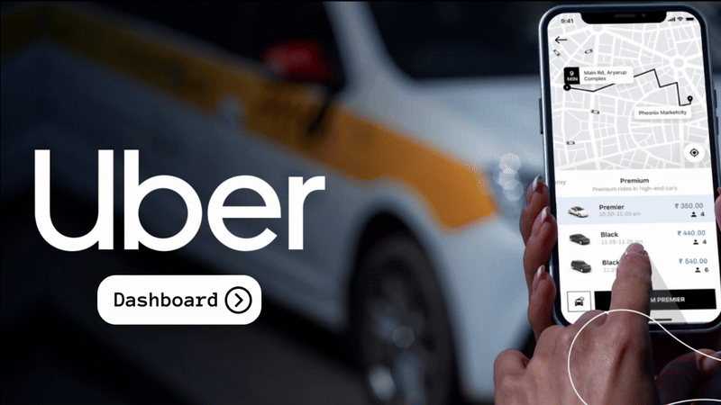

# Uber NCR Ride Bookings: Power BI Dashboard

An interactive, five-page Power BI dashboard that analyses **150,000 Uber ride-booking records from the Delhi NCR region (1 Jan 2024 to 30 Dec 2024)**. It covers booking volume, vehicle-type performance, revenue, cancellations and customer/driver ratings.



---

## Table of Contents
1. [Project Overview](#1-project-overview)
2. [Repository Contents](#2-repository-contents)
3. [Dataset Description](#3-dataset-description)
4. [Data Cleaning in Power Query Editor](#4-data-cleaning-in-power-query-editor)
5. [Data Modeling and DAX Measures](#5-data-modeling-and-dax-measures)
6. [Dashboard Deep Dive (page by page)](#6-dashboard-deep-dive-page-by-page)
7. [Key Insights](#7-key-insights)
8. [Design and UX Decisions](#8-design-and-ux-decisions)
9. [How to Open and Use](#9-how-to-open-and-use)
10. [Tools and Skills Demonstrated](#10-tools-and-skills-demonstrated)
11. [Possible Improvements](#11-possible-improvements)

---

## 1. Project Overview

**Business problem:** a ride-hailing operator needs to know where bookings succeed or fail, which vehicle categories earn the most, how customers pay, why rides get cancelled, and how riders and drivers rate each other.

**Approach:**
1. Import the raw CSV into Power BI.
2. Clean and type the data in **Power Query Editor**.
3. Build a lean **data model** with custom **DAX measures**.
4. Design a navigable, five-page report with consistent date filtering.

**Questions the dashboard answers**

| Area | Question |
|---|---|
| Overall | How many bookings were made, how did they end, and how does volume move over the year? |
| Vehicle Type | Which vehicle categories generate the most booking value and distance? |
| Revenue | How is revenue split across payment methods, and who are the top customers? |
| Cancellation | What share of bookings is cancelled, and for what reasons (customer vs driver)? |
| Ratings | How do customers and drivers rate each vehicle type? |

---

## 2. Repository Contents

| File | Description |
|---|---|
| `Uber.pbix` | Power BI report (Power Query, data model, DAX, five report pages) |
| `ncr_ride_bookings.csv` | Raw dataset (150,000 rows x 21 columns) |
| `Dasboard.gif` | Animated walkthrough of the dashboard |
| `README.md` | This documentation |

---

## 3. Dataset Description

**Source file:** `ncr_ride_bookings.csv` | **Rows:** 150,000 | **Columns:** 21 | **Period:** 2024-01-01 to 2024-12-30
**Cardinality:** 7 vehicle types, 176 distinct pickup locations, 176 distinct drop locations, about 148.8K distinct customers.

| Column | Type | Meaning |
|---|---|---|
| `Date`, `Time` | Date, Time | When the booking was made |
| `Booking ID` | Text | Booking identifier (not fully unique; see section 4) |
| `Booking Status` | Text | `Completed`, `Cancelled by Driver`, `Cancelled by Customer`, `No Driver Found`, `Incomplete` |
| `Customer ID` | Text | Customer identifier |
| `Vehicle Type` | Text | Auto, Bike, eBike, Go Mini, Go Sedan, Premier Sedan, Uber XL |
| `Pickup Location`, `Drop Location` | Text | Origin and destination |
| `Avg VTAT` | Decimal | Average vehicle turn-around time, i.e. how long a vehicle takes to reach the pickup (minutes) |
| `Avg CTAT` | Decimal | Average customer turn-around time (minutes) |
| `Cancelled Rides by Customer` / `by Driver` | Whole number | Flag, 1 if cancelled by that party |
| `Reason for cancelling by Customer` | Text | Wrong Address, Change of plans, Driver is not moving towards pickup location, Driver asked to cancel, AC is not working |
| `Driver Cancellation Reason` | Text | Customer related issue, The customer was coughing/sick, Personal & Car related issues, More than permitted people in there |
| `Incomplete Rides` / `Incomplete Rides Reason` | Whole number, Text | Flag and reason (Vehicle Breakdown, Customer Demand, Other Issue) |
| `Booking Value` | Whole number | Fare value in INR |
| `Ride Distance` | Decimal | Distance in km |
| `Driver Ratings`, `Customer Rating` | Decimal | Rating on a 1 to 5 scale |
| `Payment Method` | Text | UPI, Cash, Uber Wallet, Credit Card, Debit Card |

**Status distribution in the raw data**

| Booking Status | Rows | Share |
|---|---:|---:|
| Completed | 93,000 | 62.0% |
| Cancelled by Driver | 27,000 | 18.0% |
| No Driver Found | 10,500 | 7.0% |
| Cancelled by Customer | 10,500 | 7.0% |
| Incomplete | 9,000 | 6.0% |

---

## 4. Data Cleaning in Power Query Editor

The raw file is a flat, "wide" export in which most columns only apply to *some* booking outcomes. For example, `Booking Value`, `Payment Method` and ratings exist only for rides that actually happened, and each cancellation reason exists only for the matching cancellation. Cleaning therefore focuses on making every column load with the **correct type** and in a **usable shape**.

### 4.1 Applied steps (from the Power Query M script in `Uber.pbix`)

```m
let
    Source = Csv.Document(
        File.Contents("C:\Projects\Uber Booking\ncr_ride_bookings.csv"),
        [Delimiter=",", Columns=21, Encoding=1252, QuoteStyle=QuoteStyle.None]),
    #"Promoted Headers" = Table.PromoteHeaders(Source, [PromoteAllScalars=true]),
    #"Changed Type" = Table.TransformColumnTypes(#"Promoted Headers", {
        {"Date", type date}, {"Time", type time},
        {"Booking ID", type text}, {"Booking Status", type text},
        {"Customer ID", type text}, {"Vehicle Type", type text},
        {"Pickup Location", type text}, {"Drop Location", type text},
        {"Avg VTAT", type number}, {"Avg CTAT", type number},
        {"Cancelled Rides by Customer", Int64.Type},
        {"Reason for cancelling by Customer", type text},
        {"Cancelled Rides by Driver", Int64.Type},
        {"Driver Cancellation Reason", type text},
        {"Incomplete Rides", Int64.Type},
        {"Incomplete Rides Reason", type text},
        {"Booking Value", Int64.Type}, {"Ride Distance", type number},
        {"Driver Ratings", type number}, {"Customer Rating", type number},
        {"Payment Method", type text}})
in
    #"Changed Type"
```

| # | Step | What it does | Why it matters |
|---|---|---|---|
| 1 | **Source** (`Csv.Document`) | Reads the CSV with comma delimiter, 21 columns, Windows-1252 encoding | Guarantees the correct column count and character decoding |
| 2 | **Promoted Headers** | Turns the first row into column names | Gives meaningful field names such as `Booking Status`, `Vehicle Type` |
| 3 | **Changed Type** | Assigns the correct data type to all 21 columns | Enables date hierarchy, numeric aggregation (SUM/AVERAGE) and correct sorting |

### 4.2 Type conversions in detail

| Columns | Converted to | Benefit |
|---|---|---|
| `Date` | Date | Power BI auto-builds a **Year > Quarter > Month > Day hierarchy**, used by the time charts and the date slicer |
| `Time` | Time | Allows hour-of-day analysis |
| `Booking Value`, `Cancelled Rides by Customer`, `Cancelled Rides by Driver`, `Incomplete Rides` | Whole number | Revenue is summed exactly, and the 1/0 flags can be summed as counts |
| `Ride Distance`, `Avg VTAT`, `Avg CTAT`, `Driver Ratings`, `Customer Rating` | Decimal | Preserves decimals for distances, times and ratings |
| `Booking ID`, `Customer ID`, `Booking Status`, `Vehicle Type`, locations, reasons, `Payment Method` | Text | Used as categories, slicer values and chart axes |

### 4.3 Data-quality observations that shaped the model

These are properties of the raw file that the report design takes into account:

| Observation | Detail | How the dashboard handles it |
|---|---|---|
| **Structural blanks** | After loading, `Booking Value`, `Ride Distance`, `Payment Method` are empty for 48,000 rows (cancelled, no-driver and incomplete bookings). Ratings are empty for 57,000 rows. Reason columns are empty unless they apply | Revenue, distance and rating visuals only aggregate rows that have values, so nothing is distorted. Reason pies include only the matching rows |
| **Text-quoted identifiers** | `Booking ID` and `Customer ID` are stored with embedded quotation marks (e.g. `"CNR5884300"`), because the file was read with `QuoteStyle.None` | They are kept as text keys. They are only counted or listed, never calculated on |
| **Repeated Booking IDs** | 150,000 rows contain **148,767 distinct** Booking IDs (1,233 repeats) | **Total Bookings uses a distinct count of `Booking ID`**, which is why the dashboard shows **148.77K** rather than 150K |
| **Consistent categories** | Vehicle types, payment methods and status values are spelled consistently | Slicers, legends and per-vehicle filters work with no re-mapping |
| **Date range** | 1 Jan 2024 to 30 Dec 2024 | The date slicer is bound to this range |

> Note: the saved query in `Uber.pbix` contains the three steps above. If you applied any extra clean-up in Power Query beyond these steps, add them to the table in 4.1.

---

## 5. Data Modeling and DAX Measures

### 5.1 Model structure
The model is a single-fact-table design:

| Table | Role |
|---|---|
| `ncr_ride_bookings` | Fact table (150,000 rows, 21 columns) plus the custom measures |
| `LocalDateTable_...` | Auto-generated date table linked to `ncr_ride_bookings[Date]`, providing Year, Quarter, Month, Day |
| `DateTableTemplate_...` | Power BI's hidden date template (system-generated) |

Because every visual draws from one flat table, no relationships need to be maintained between business tables. This keeps filtering simple and fast, and all slicers cross-filter every visual on a page.

### 5.2 Custom measures (DAX)

```DAX
TotalBooking =
COUNTROWS ( ncr_ride_bookings )

CanceledBookings =
CALCULATE (
    COUNTROWS ( ncr_ride_bookings ),
    ncr_ride_bookings[Booking Status]
        IN { "Cancelled by Driver", "Cancelled by Customer" }
)

CanceledPercentage =
DIVIDE ( [CanceledBookings], [TotalBooking], 0 ) * 100
```

| Measure | Logic | Used for |
|---|---|---|
| **TotalBooking** | Counts every row in the current filter context | Denominator for the cancellation rate |
| **CanceledBookings** | Counts rows whose status is *Cancelled by Driver* **or** *Cancelled by Customer*. `CALCULATE` overrides the status filter, and `IN` handles both values in a single expression | Numerator for the cancellation rate |
| **CanceledPercentage** | `CanceledBookings / TotalBooking x 100`. `DIVIDE(..., 0)` returns 0 instead of an error when the denominator is empty | The **Cancellation Rate** KPI card (25%) |

**Why measures instead of calculated columns?** Measures are evaluated at query time in the current filter context, so they respond to the date slicer and to any cross-filter, and they add nothing to file size.

### 5.3 Implicit aggregations (field-level calculations)
Besides the three DAX measures, the visuals use built-in aggregations configured on columns:

| Metric shown | Aggregation | Field |
|---|---|---|
| Total Bookings (cards) | Distinct count | `Booking ID` |
| Success / Cancelled Bookings (cards) | Distinct count of `Booking ID`, with a visual-level filter on `Booking Status` (`Completed` / the two cancellation statuses) | `Booking ID` |
| Total / Success Booking Value | Sum | `Booking Value` (the success column is filtered to completed rides) |
| Total Distance Travelled | Sum | `Ride Distance` |
| Avg. Distance Travelled | Average | `Ride Distance` |
| Customer and Driver ratings | Average per vehicle type | `Customer Rating`, `Driver Ratings` |
| Cancellation reason pies | Sum of flags | `Cancelled Rides by Customer`, `Cancelled Rides by Driver` |

### 5.4 Slicer-driven filtering
A **Date range slicer** (between-style slider, 1/1/2024 to 12/30/2024) is placed on each analytical page. It filters every card, chart and table on that page through the date column.

---

## 6. Dashboard Deep Dive (page by page)

**Global layout**
- A fixed **left navigation panel** with the Uber logo and five buttons (Overall, Vehicle Type, Revenue, Cancellation, Ratings). The active page is highlighted with a white pill.
- A back arrow in the top-left corner and a branded landing page ("Dashboard" button) that opens the report.
- A monochrome grey/black palette in card-style panels, matching Uber's minimal brand.
- All pages use a 1280 x 720 canvas.

### Page 0: Home / Landing Page
A branded cover with the Uber wordmark, a blurred taxi photo, a phone mock-up of the Uber app and a **Dashboard** button that navigates into the report.

### Page 1: Overall

| Visual | Type | Fields | Purpose |
|---|---|---|---|
| **DATE** | Range slicer | `Date` | Restricts the whole page to a period |
| **Total Bookings** | Card | Distinct count of `Booking ID` | Headline KPI: **148.77K** |
| **Booking Status Breakdown** | Pie chart with count and % labels | `Booking Status`, count | Outcome mix: Completed **93K (65.96%)**, Cancelled by Driver **27K (19.15%)**, Cancelled by Customer **10.5K (7.45%)**, No Driver Found **10.5K (7.45%)** |
| **Ride Volume Over Time** | Area/line chart | Date hierarchy (Year > Quarter > Month > Day), count of `Booking ID` | Seasonality across Jan to Dec |

**How to read it**
- Clicking a pie slice cross-filters the page. In the walkthrough, selecting *Completed* drops **Total Bookings from 148.77K to 92.55K** and redraws the volume trend for completed rides only.
- Monthly volume sits in a narrow band (roughly 12.0K to 13.0K bookings), with a visible **dip in February** and peaks in **January, March, May and July**.

### Page 2: Vehicle Type
A matrix-style scorecard built from icon-labelled rows and **card visuals**, each filtered to one vehicle category (the two-wheelers, Bike and eBike, are combined in one row).

| Vehicle Type | Total Booking Value | Success Booking Value | Avg. Distance Travelled | Total Distance Travelled |
|---|---:|---:|---:|---:|
| Go Mini | 10.34M | 9.41M | 25.99 | 482K |
| Go Sedan | 9.37M | 8.54M | 25.98 | 433K |
| Uber XL | 1.53M | 1.41M | 25.72 | 72K |
| Premier Sedan | 6.28M | 5.73M | 25.95 | 292K |
| Auto | 12.88M | 11.73M | 25.99 | 602K |
| eBike / Bike | 11.46M | 10.44M | 26.11 | 537K |

**How it is built:** 24 card visuals form the grid: Total Booking Value and Success Booking Value are `Sum(Booking Value)`, and the two distance columns are `Sum(Ride Distance)` and `Average(Ride Distance)`. Each card carries a `Vehicle Type` filter, and the success column also filters on completed rides. The date slicer is at the top.

**Reading it**
- **Auto** is the highest-earning category (12.88M total, 11.73M successful).
- **Bike + eBike** together are second (11.46M), followed by **Go Mini** (10.34M).
- **Uber XL** is the smallest (1.53M).
- The gap between *Total* and *Success* value is the revenue lost to cancellations and incomplete rides, roughly 9 to 10% for every category.
- Average trip distance is nearly identical across vehicle types (about 26 km), so differences in revenue come from **volume of trips**, not trip length.

### Page 3: Revenue

| Visual | Type | Fields | Insight |
|---|---|---|---|
| **Ride Distance Distribution** | Column chart | Day (date hierarchy), `Sum(Ride Distance)` | Daily distance is steady across the month (about 7K km/day) with mild dips mid-month |
| **Revenue by Payment Method** | Column chart | `Payment Method`, `Sum(Booking Value)` | **UPI leads**, followed by **Cash**, then Uber Wallet, Credit Card and Debit Card |
| **Top 5 Customers** | Table | `Customer ID`, `Sum(Booking Value)` | Lists the highest-spending customers (top 5 total shown: 19,826) |
| **DATE** | Range slicer | `Date` | Re-computes all three visuals for any period |

**Reading it**
- Digital payments (UPI + Wallet + Cards) clearly outweigh Cash. On the full dataset UPI contributes about 23.3M of 51.8M total booking value (45%), and Cash about 12.9M (25%).
- The Top-5 table is a quick way to spot high-value accounts.

### Page 4: Cancellation

| Visual | Type | Fields |
|---|---|---|
| **Cancelled Rides by Customers** | Pie chart | `Reason for cancelling by Customer`, `Sum(Cancelled Rides by Customer)` |
| **Cancelled Rides by Drivers** | Pie chart | `Driver Cancellation Reason`, `Sum(Cancelled Rides by Driver)` |
| **Total Bookings** | KPI card | Distinct count of `Booking ID`: **148.77K** |
| **Success Bookings** | KPI card | Distinct count, filtered to `Completed`: **92.55K** |
| **Cancelled Bookings** | KPI card | Distinct count, filtered to the two cancellation statuses: **37.43K** |
| **Cancellation Rate** | KPI card | DAX measure `CanceledPercentage`: **25%** |
| **DATE** | Range slicer | `Date` |

**Reading it**
- **Customer-side reasons** are spread almost evenly: Wrong Address (22.5%), Change of plans (22.4%), Driver is not moving towards pickup (22.2%), Driver asked to cancel (21.9%), AC not working (11%).
- **Driver-side reasons** are also near-uniform (about 25% each): Customer related issue, Customer coughing/sick, Personal & Car related issues, More than permitted people.
- A **25% cancellation rate** is the single most important health metric on this page. Cancellations driven by the *driver* (27K) are about 2.6 times those driven by the *customer* (10.5K).
- Several customer reasons (*Driver is not moving towards pickup*, *Driver asked to cancel*) are actually **supply-side** problems, which means the operational share of cancellations is higher than the headline split suggests.

### Page 5: Ratings
Two rows of icon-labelled cards, one per vehicle type (Go Mini, Go Sedan, UberXL, Premier Sedan, Auto, Bike, eBike).

| Row | Result |
|---|---|
| **Customer Ratings** (riders rating the experience) | about **4.40** across all vehicle types (Go Sedan 4.41) |
| **Driver Ratings** (drivers rating riders) | about **4.23** across all vehicle types (UberXL 4.24) |

**Reading it:** satisfaction is high but **uniform**. No vehicle category stands out as better or worse, so service-quality issues are more likely tied to *availability and cancellations* than to vehicle class.

---

## 7. Key Insights

1. **Volume:** about 148.8K distinct bookings in 2024, a stable 12K to 13K per month with a February dip.
2. **Conversion:** only about **62% of booking records complete**. Roughly 25% are cancelled, and 7% fail with *No Driver Found*.
3. **Vehicles:** Auto, Bike/eBike and Go Mini produce most of the revenue. Premium categories (Premier Sedan, Uber XL) are comparatively small.
4. **Revenue leakage:** about 9 to 10% of booked value in every vehicle category is lost to non-completed rides.
5. **Payments:** UPI is the dominant payment method, followed by Cash.
6. **Cancellations:** driver-initiated cancellations dominate, and their reasons are evenly distributed, pointing to process and supply issues rather than one root cause.
7. **Ratings:** consistently about 4.4 (customers) and about 4.2 (drivers) across every category.

---

## 8. Design and UX Decisions

- **Page navigation with buttons and bookmarks-style highlighting** so the report behaves like an app.
- **One date slicer per page**, with the same interaction model everywhere.
- **Card visuals filtered per vehicle** to create a custom, icon-rich scorecard that a standard table cannot achieve.
- **Distinct count of Booking ID** for bookings, to avoid double-counting repeated IDs.
- **Monochrome theme** to keep attention on the numbers.
- **Cross-filtering enabled** so pie slices and chart bars act as filters.

---

## 9. How to Open and Use

1. Install **Power BI Desktop** (Windows).
2. Open `Uber.pbix`.
3. If Power BI shows a data-source error, go to **Home > Transform data > Data source settings** and re-point the source to your local copy of `ncr_ride_bookings.csv` (the original path was `C:\Projects\Uber Booking\`).
4. Click **Refresh**.
5. Use the left navigation to switch pages, and the **date slider** to filter by period.

---

## 10. Tools and Skills Demonstrated

- **Power BI Desktop:** report design, navigation, slicers, cross-filtering
- **Power Query (M):** CSV import, header promotion, type enforcement
- **Data modeling:** single fact table, auto date table, date hierarchy
- **DAX:** `COUNTROWS`, `CALCULATE`, `IN`, `DIVIDE`
- **Data storytelling:** KPI cards, pie, area and column charts, scorecards

---

## 11. Possible Improvements

- Remove stray quotation marks from `Booking ID` and `Customer ID` in Power Query, and store `Booking Value` etc. with explicit null handling.
- Create a proper **Date dimension** and **Vehicle dimension** for a star schema.
- Add measures such as **Average Booking Value**, **Completion Rate %**, **Revenue per km** and **Month-over-Month growth**.
- Add a **hour-of-day** heat map using `Time`, and a **top pickup/drop locations** map.
- Add `No Driver Found` and `Incomplete` rides to the cancellation analysis, including incomplete-ride reasons.
- Replace the repeated per-vehicle cards with a single matrix that uses a `Vehicle Type` axis.

---

*Dataset: Uber NCR ride bookings (2024). Dashboard built with Power BI Desktop.*
